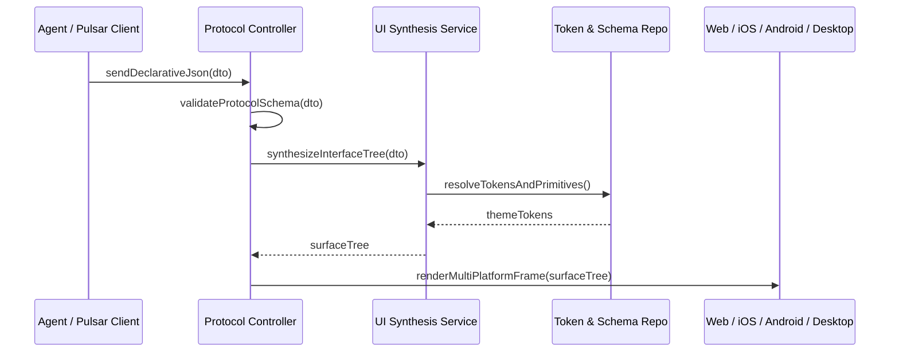

<p align="center"></p>

<h1 align="center">Aurora</h1>
<p align="center"><strong>Sovereign dynamic multi-device UI/UX rendering engine in pure native Rust across Web, Mobile, and Desktop</strong></p>

<p align="center">
  
  
  
  
  <a href="LICENSE"></a>
  <a href="https://natuleadan.com"></a>
</p>

## 1. What is Aurora?

Aurora is a 100% pure native Rust **dynamic multi-device UI/UX rendering engine** implementing the declarative agent-to-UI JSON protocol natively in Rust. Given incoming structured data or agent-emitted agent-to-UI JSON payloads over decoupled wire protocols (REST, WebSocket/WSS, gRPC), Aurora dynamically synthesizes safe, responsive interfaces across **Web, iOS, Android, macOS, and Windows** and serves as the client-side rendering engine for Pulsar with zero direct Cargo crate coupling.

### What is inside

Aurora is structured around a layered modular six-file modular architecture (`entity`, `dto`, `repository`, `service`, `controller`, `mod`) atop a pure-Cargo workspace (`crates/core` and `crates/xtask`), combining design tokens, primitives, a native node-graph canvas, and an agent-to-UI schema renderer verified by eight validation gates.

> **Current scope:** This release ships the native validation harness, the six-file modular reference domain (`modules/math`), and the crate contracts. Transports, sandboxes, domain engines and protocol integrations described throughout this document are planned milestones, not shipped capabilities.

## 2. Why Aurora?

Most AI interfaces either hardcode static frontend templates or allow agents to emit unsafe raw HTML/JavaScript inside bloated browser runtimes.

- **Agent-driven UI/UX auto-generation**: Agents send structured JSON protocol messages; Aurora deterministically synthesizes and updates the live interface.
- **True multi-platform export**: One pure-Rust UI core targeting Web, iOS, Android, macOS, and Windows with consistent design tokens.
- **Required client engine for Pulsar**: Provides the client-side visual surface for Pulsar agent swarms without browser-wrapper or JavaScript runtime overhead.
- **Deterministic headless verification**: Token contrast, layout invariants, and declarative schemas are verified in headless Rust tests.

## 3. Highlights

- **Native agent-to-UI JSON renderer**: Type-safe schema validation and incremental surface patching directly in Rust.
- **Multi-platform native shell**: Cross-target rendering architecture spanning desktop, mobile, and web environments.
- **Design tokens & primitives**: Semantic themes, accessible contrast scales, and composable layout primitives.
- **Eight standardized validation gates**: Full parity covering lint, typecheck, unit tests, architecture boundaries, cooldown, hygiene, notices, and releases.
- **Zero formatter drift**: Formatters are excluded from hooks and CI so every diff reflects real architectural logic.

## 4. Quick Start

Ensure Rust `1.85+` (Rust 2024 edition / stable, matching `rust-version = "1.85"`) is installed:

```bash
# Clone the repository
git clone https://github.com/natuleadan/aurora.git
cd aurora

# Activate local hooks
git config core.hooksPath .githooks

# Run the complete 8-gate native validation suite
cargo xtask validate
```

Other native `xtask` operations:

```bash
cargo xtask notices          # Regenerate ThirdPartyNotices.txt from cargo metadata
cargo xtask release --check  # Verify Cargo.toml version and CHANGELOG parity
cargo test --workspace       # Execute unit, integration, and architecture tests
```

## 5. Use Cases

- **Pulsar multi-platform client**: Render live agent conversations, approval cards, task boards, and swarm telemetry across Web, iOS, Android, macOS, and Windows.
- **Auto-generated operational dashboards**: Let backend services or agents stream JSON UI descriptions that adapt automatically to screen size and platform.
- **Visual workflow graphs**: Render interactive node-graph execution DAGs and real-time inspectors at native frame rates.

## 6. How It Works



Agents emit declarative JSON payloads to the `controller`, which validates the schema via `dto`, resolves tokens and layout rules inside `service`, and dispatches cross-platform frames to Web, iOS, Android, macOS, or Windows renderers.

## 7. Status and Roadmap

- **Status**: Initial foundation — validation harness and modular reference skeleton in place; domain implementation in progress.
- **Milestone 1**: Core design tokens, layout primitives, and native agent-to-UI JSON schema decoder.
- **Milestone 2**: Interactive node-graph canvas engine and multi-platform export targets (Web, iOS, Android, macOS, Windows).
- **Milestone 3**: Full decoupled wire-protocol (REST, WSS, gRPC) client integration with Pulsar and headless visual regression matrix.

## 8. Repository Layout & Validation Gates

```text
.
├── .cargo/                  # Cargo configuration and 3-day cooldown resolver
├── .githooks/               # Versioned commit-msg, pre-commit, and pre-push hooks
├── .github/                 # Issue templates, dependabot config, and CI workflows
├── crates/
│   ├── core/                # Core UI engine library (modules/math reference domain, lib.rs)
│   │   └── tests/           # integration.rs and immutable architecture.rs tripwires
│   └── xtask/               # Pure-Rust automation CLI (cargo xtask <cmd>)
├── .env.example             # Environment contract template (copy to git-ignored .env)
├── Cargo.toml               # Workspace manifest (rust-version = "1.85", [workspace.lints])
├── clippy.toml              # Strict Clippy policy (max-fn-params-bools = 0)
├── ARCHITECTURE.md          # Modular domain architecture specifications
├── AGENTS.md                # Autonomous AI agent operating guidelines
├── CONTRIBUTING.md          # Contribution workflow and commit grammar
├── SECURITY.md              # Supply-chain policies and vulnerability reporting
├── LICENSE                  # Apache-2.0 License
├── NOTICE                   # Copyright (c) 2026 Natuleadan.
└── ThirdPartyNotices.txt    # Automated third-party license inventory
```

| Gate | Command | Purpose |
| :--- | :--- | :--- |
| `lint` | `cargo clippy --workspace --all-targets --all-features -- -D warnings` + `cargo doc -D warnings` | Strict zero-warning static analysis and rustdoc checks |
| `typecheck` | `cargo check --workspace --all-targets` | Workspace type verification |
| `unit tests` | `cargo test --workspace --lib` + `--doc` | Library unit tests and runnable doc examples |
| `integration and architecture tests` | `cargo test --workspace --test '*'` | Integration flows and layer tripwires |
| `cooldown` | `cargo --config 'resolver.min-publish-age="3 days"'` | 3-day package release cooldown |
| `hygiene` | `crates/xtask/src/hygiene.rs` | 500-line limit, anti-leak, and syntax checks |
| `notices` | `crates/xtask/src/notices.rs` | License inventory parity check |
| `release` | `crates/xtask/src/release.rs` | SemVer and CHANGELOG consistency |

## 9. Documentation

- [ARCHITECTURE.md](ARCHITECTURE.md): Modular architecture, layer boundaries, and design invariants.
- [CONTRIBUTING.md](CONTRIBUTING.md): Issue-first contribution policy, PR workflow, and commit grammar.
- [SECURITY.md](SECURITY.md): Vulnerability disclosure procedures and supply-chain controls.
- [AGENTS.md](AGENTS.md): Machine-facing instructions for autonomous engineering.

## 10. Ecosystem & Community

Aurora powers the client-side multi-platform agent-to-UI interface of Pulsar over decoupled wire protocols (REST, WSS, gRPC), alongside Orion, Andromeda, Pleaides, Caelum, Lyra, and Skills.

<p align="left">
  <a href="https://github.com/natuleadan"></a>
  <a href="https://github.com/leojara95"></a>
</p>

Bug reports and feature proposals are tracked via structured GitHub Issues.

## 11. Contributing

External pull requests are restricted to maintainers (`collaborators_only`). Please open an issue describing your bug or proposal. See [CONTRIBUTING.md](CONTRIBUTING.md) for details.

## 12. License & Star History

This project is licensed under the Apache License 2.0. Copyright (c) 2026 Natuleadan.

Terms are in [LICENSE](LICENSE), attribution in [NOTICE](NOTICE), and third-party dependency notices in [ThirdPartyNotices.txt](ThirdPartyNotices.txt).

<a href="https://www.star-history.com/#natuleadan/aurora&Date">
  <picture>
    <source media="(prefers-color-scheme: dark)" srcset="https://api.star-history.com/image?repos=natuleadan/aurora&type=date&theme=dark" />
    <source media="(prefers-color-scheme: light)" srcset="https://api.star-history.com/image?repos=natuleadan/aurora&type=date&theme=light" />
    
  </picture>
</a>
